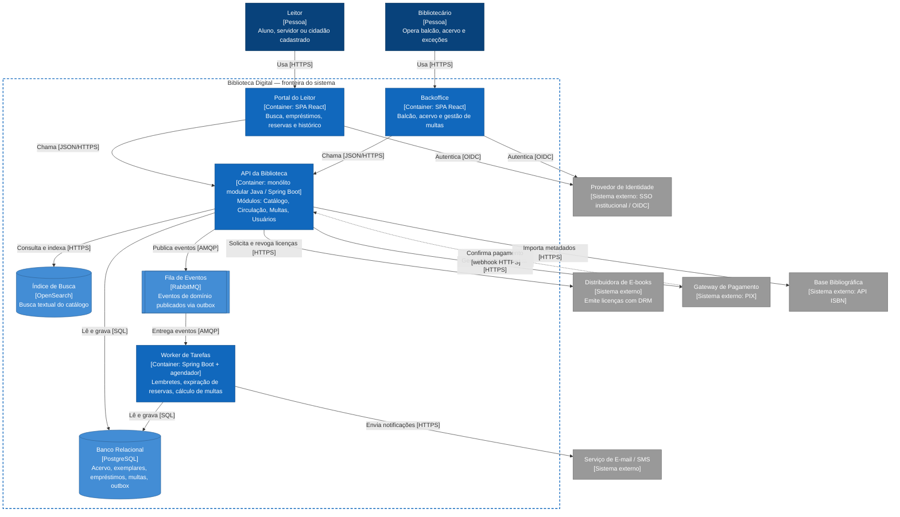
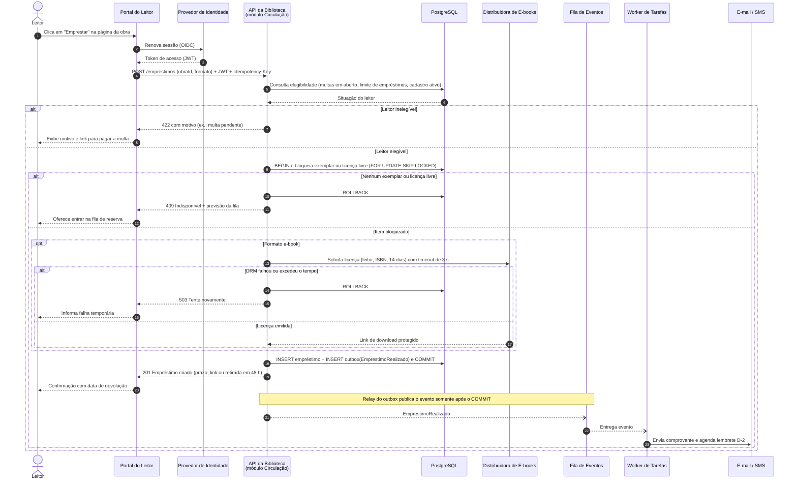

# Biblioteca Digital — Arquitetura documentada com apoio de GenAI

Este repositório descreve a arquitetura de um sistema de **biblioteca digital** com empréstimo de livros físicos e e-books. Ele reúne a descrição em linguagem natural, os diagramas em Mermaid gerados com apoio de GenAI e o registro das decisões e ajustes feitos sobre o que o modelo produziu.

## Sumário

1. [Descrição do sistema](#1-descrição-do-sistema)
2. [Diagrama estrutural: containers (C4 nível 2)](#2-diagrama-estrutural-containers-c4-nível-2)
3. [Diagrama comportamental: jornada de empréstimo](#3-diagrama-comportamental-jornada-de-empréstimo)
4. [Como a GenAI foi usada](#4-como-a-genai-foi-usada)
5. [Decisões e ajustes sobre a saída da GenAI](#5-decisões-e-ajustes-sobre-a-saída-da-genai)
6. [Estrutura do repositório](#6-estrutura-do-repositório)

---

## 1. Descrição do sistema

### 1.1 Contexto e propósito

A Biblioteca Digital atende uma rede de bibliotecas públicas e universitárias. Ela permite que leitores pesquisem o acervo, emprestem livros físicos (com retirada no balcão) e e-books (com download protegido por DRM), entrem em filas de reserva e paguem multas por atraso via PIX. Os bibliotecários usam o mesmo sistema para operar o balcão, manter o acervo e tratar exceções.

### 1.2 Escopo

**Dentro do escopo**

- **Catálogo:** cadastro de obras e exemplares, importação de metadados por ISBN e busca textual.
- **Circulação:** empréstimo, renovação, devolução e fila de reserva, para livros físicos e e-books.
- **Multas:** cálculo automático por dia de atraso, cobrança via PIX e bloqueio de novos empréstimos enquanto houver débito.
- **Notificações:** comprovantes, lembretes de vencimento (D-2), aviso de reserva disponível e de multa gerada.
- **Usuários:** perfil do leitor, limites por categoria (aluno, servidor, cidadão) e histórico.

**Fora do escopo**

- Aquisição de acervo, compras e gestão de fornecedores.
- Leitor de e-books próprio (a leitura acontece no aplicativo da distribuidora).
- Empréstimo entre bibliotecas de redes diferentes.
- Autenticação e cadastro de identidade, que são delegados ao SSO institucional.

### 1.3 Nível da visão

A documentação está no **nível 2 do modelo C4 (containers)**: mostra as aplicações e os armazenamentos que compõem o sistema, as tecnologias de cada um e os protocolos entre eles. Não detalha componentes internos (nível 3) nem código (nível 4). O comportamento é descrito por um diagrama de sequência da jornada mais crítica, o empréstimo.

### 1.4 Limites e responsabilidades

| Container | Responsabilidade | Não é responsável por |
|---|---|---|
| **Portal do Leitor** (SPA React) | Busca, solicitação de empréstimo, reservas, renovação, histórico e pagamento de multas | Regras de negócio (todas ficam na API) |
| **Backoffice** (SPA React) | Operação de balcão (retirada e devolução física), manutenção do acervo, isenção de multas | Autenticação (delegada ao SSO) |
| **API da Biblioteca** (monólito modular Spring Boot) | Única dona das regras de negócio e dos dados. Módulos: Catálogo, Circulação, Multas e Usuários, com fronteiras explícitas entre pacotes | Envio de notificações e rotinas agendadas |
| **Worker de Tarefas** | Consome eventos de domínio, envia notificações, expira reservas não retiradas em 48 h e calcula multas diariamente | Atender requisições de usuários |
| **PostgreSQL** | Fonte da verdade transacional, incluindo a tabela de *outbox* | Busca textual |
| **OpenSearch** | Índice de busca do catálogo, derivado do PostgreSQL | Ser fonte da verdade (pode ser reconstruído) |
| **RabbitMQ** | Transporte assíncrono de eventos de domínio | Persistência de longo prazo |

### 1.5 Integrações externas

| Sistema | Finalidade | Protocolo | Comportamento em falha |
|---|---|---|---|
| Provedor de Identidade (SSO institucional) | Login e emissão de tokens | OIDC / JWT | Sem login não há operação. Sessões ativas seguem válidas até expirar |
| Distribuidora de E-books | Emitir e revogar licenças com DRM | REST/HTTPS | Timeout de 3 s. O empréstimo de e-book é recusado com 503 e nada é gravado |
| Gateway de Pagamento (PIX) | Cobrança de multas | REST + webhook | A multa fica "em aberto" até o webhook confirmar o pagamento |
| Serviço de E-mail / SMS | Notificações | REST/HTTPS | Reenvio com *backoff* pelo Worker. Não bloqueia empréstimos |
| Base Bibliográfica (API ISBN) | Importar metadados de obras | REST/HTTPS | O bibliotecário cadastra manualmente |

### 1.6 Restrições

- **Equipe pequena:** 4 desenvolvedores, o que favorece poucos artefatos implantáveis.
- **Orçamento público:** preferência por software livre e por infraestrutura gerenciada de baixo custo.
- **LGPD:** o histórico de leitura é dado pessoal. É exibido só ao próprio leitor e anonimizado após 5 anos.
- **Licenciamento de e-books:** cada título tem um número limitado de licenças simultâneas, definido em contrato.
- **Disponibilidade:** 99,5 % em horário de funcionamento. Picos no início de semestre letivo.
- **Acessibilidade:** o portal deve atender à WCAG 2.1 AA.

### 1.7 Lacunas e premissas em aberto

- **Contrato com a distribuidora de e-books:** os limites de chamadas por minuto e a API de revogação não foram confirmados. O timeout de 3 s é uma premissa.
- **Regras de multa:** o valor diário, o teto e as isenções (ex.: greve, feriado) ainda dependem de normativa da biblioteca.
- **Chamada externa dentro da transação:** a licença de e-book é solicitada com o exemplar bloqueado no banco. Isso é aceitável no volume esperado, mas, se houver muita contenção, a alternativa é um estado intermediário "licença pendente" com compensação.
- **Leitores sem vínculo institucional:** não está definido como cidadãos sem conta no SSO serão cadastrados.
- **Observabilidade e recuperação de desastre:** RPO e RTO não foram definidos.
- **Atividades de balcão:** a retirada e a devolução física têm fluxos próprios, que não foram diagramados.
- **Valores inferidos pela GenAI:** prazos, timeouts e outros valores numéricos dos diagramas são premissas, não decisões. Veja a [seção 5.4](#54-suposições-da-genai-ainda-não-validadas).

---

## 2. Diagrama estrutural: containers (C4 nível 2)

Fonte: [`diagramas/containers.mmd`](diagramas/containers.mmd)



**Legenda:** azul-escuro = pessoas · azul = containers do sistema · azul-claro = armazenamento e mensageria · cinza = sistemas externos · linha tracejada = chamada de retorno (webhook).

---

## 3. Diagrama comportamental: jornada de empréstimo

O empréstimo foi escolhido como jornada crítica porque concentra as regras de negócio mais sensíveis: elegibilidade, disputa pelo último exemplar, licença de e-book e consistência entre banco e notificações.

Fonte: [`diagramas/sequencia-emprestimo.mmd`](diagramas/sequencia-emprestimo.mmd)



**Leitura do fluxo**

- **Passos 1–4:** o portal garante um token válido e envia a solicitação com uma `Idempotency-Key`. Assim, um duplo clique ou um reenvio após timeout não gera dois empréstimos.
- **Passos 5–8:** a elegibilidade é verificada antes de qualquer bloqueio, para não segurar exemplares de quem não pode emprestar.
- **Passos 9–12:** `FOR UPDATE SKIP LOCKED` resolve a disputa pelo último exemplar. Se dois leitores pedem ao mesmo tempo, um bloqueia o item e o outro recebe 409 imediatamente, sem esperar.
- **E-book:** a licença é obtida antes do `COMMIT`. Se a distribuidora falhar, nada é gravado.
- **Pós-commit:** a notificação sai pelo padrão *transactional outbox*. O e-mail só é enviado se o empréstimo foi de fato gravado, e uma indisponibilidade do provedor de e-mail não afeta o empréstimo.

---

## 4. Como a GenAI foi usada

- **Modelo:** Claude (Opus 5.5), via Claude Code no VS Code.
- **Processo:**
  1. Geração direta a partir de prompts curtos (saída `v0`).
  2. Revisão crítica da `v0` contra as restrições do sistema (seção 1.6).
  3. Prompts de refinamento com as decisões tomadas.
  4. Validação da sintaxe renderizando os diagramas com `@mermaid-js/mermaid-cli`.
- **Rastreabilidade:** os prompts estão em [`genai/prompts.md`](genai/prompts.md) e as saídas originais, sem edição, em [`genai/saida-original/`](genai/saida-original/).

---

## 5. Decisões e ajustes sobre a saída da GenAI

### 5.1 Diagrama de containers

| # | O que a GenAI gerou (v0) | Problema identificado | Ajuste aplicado |
|---|---|---|---|
| 1 | Sintaxe `C4Container` do Mermaid | É experimental: o layout no GitHub fica sobreposto e há pouco controle de posição | Reescrito como `flowchart` com `subgraph` para a fronteira e `classDef` com as cores da convenção C4 |
| 2 | Cinco microsserviços Node.js e um API Gateway Kong | Excesso de artefatos para uma equipe de 4 pessoas com orçamento público. Também acrescenta latência e falhas de rede em uma operação que precisa ser transacional (empréstimo) | **Monólito modular** com fronteiras de módulo explícitas, mais um Worker separado. Pode ser decomposto depois, se houver necessidade real |
| 3 | Um único MongoDB compartilhado por todos os serviços | Banco compartilhado entre microsserviços anula a independência entre eles. Além disso, empréstimo e multa exigem transações ACID e bloqueio de linha | **PostgreSQL** como fonte da verdade e **OpenSearch** só para busca textual |
| 4 | Notificação chamada de forma síncrona pelo serviço de empréstimo | Uma falha do e-mail derrubaria o empréstimo, e havia risco de notificar algo que sofreu rollback | **RabbitMQ + outbox**: o Worker consome os eventos depois do commit |
| 5 | Ausência de autenticação, DRM de e-books e base ISBN | Integrações essenciais estavam faltando | Inclusos o **SSO (OIDC)**, a **distribuidora de e-books** e a **API ISBN** |
| 6 | Um único "Web App" para leitor e bibliotecário | Perfis, riscos e requisitos de acessibilidade diferentes | Separado em **Portal do Leitor** e **Backoffice** |
| 7 | Relações sem protocolo ("Calls", "Routes") e rótulos em inglês | Contraria a convenção C4 (relação com tecnologia) e o público-alvo | Protocolo em todas as setas e textos em português |
| 8 | Pagamento só no sentido de ida | O PIX é assíncrono: a confirmação chega depois, por webhook | Seta tracejada de **webhook** do gateway para a API |
| 9 | Sem rotinas agendadas | Lembretes, expiração de reservas e cálculo de multas não tinham onde rodar | Esses jobs ficam no **Worker de Tarefas** |

### 5.2 Diagrama de sequência

| # | O que a GenAI gerou (v0) | Problema identificado | Ajuste aplicado |
|---|---|---|---|
| 1 | Só o caminho feliz | Uma jornada crítica sem caminhos de falha não serve para discutir o comportamento real | Blocos `alt`/`opt` para **leitor inelegível (422)**, **indisponível (409)** e **falha da DRM (503)** |
| 2 | "Check availability" seguido de "Save loan" em chamadas separadas | **Condição de corrida:** dois leitores podem emprestar o mesmo último exemplar | Bloqueio na mesma transação com `SELECT … FOR UPDATE SKIP LOCKED` |
| 3 | Sem idempotência | Um reenvio ou duplo clique cria empréstimos duplicados | Cabeçalho `Idempotency-Key` no `POST /emprestimos` |
| 4 | Notificação dentro do fluxo síncrono, antes da resposta | Acoplamento e risco de e-mail sem empréstimo | Mensagens assíncronas (`--)`) após o commit, via outbox |
| 5 | Sem autenticação | Não mostrava como a identidade do leitor chega à API | Renovação de sessão OIDC e JWT na requisição |
| 6 | Não distinguia livro físico de e-book | As regras são diferentes (licença DRM × retirada em 48 h) | Bloco `opt Formato e-book` e resposta com o prazo de cada formato |
| 7 | Sem numeração | Difícil referenciar passos na discussão | `autonumber` |

### 5.3 O que foi mantido da saída da GenAI

- A separação de responsabilidades em Catálogo, Circulação (Loan), Multas (Fine) e Usuários, que virou a divisão em **módulos** do monólito.
- A ordem geral da jornada: verificar multas, verificar disponibilidade, gravar e notificar.
- O uso de React no front-end.

### 5.4 Suposições da GenAI ainda não validadas

Durante o refinamento, o modelo preencheu lacunas com valores que *parecem* razoáveis, mas que **não vieram de nenhuma decisão ou norma da biblioteca**. Eles foram mantidos nos diagramas para tornar o fluxo concreto, mas estão registrados aqui como **premissas a validar**, não como requisitos:

| Suposição presente nos diagramas | Origem | Quem precisa validar |
|---|---|---|
| Prazo de empréstimo de e-book de **14 dias** | Inferido pela GenAI (prazo comum em bibliotecas) | Coordenação da biblioteca |
| Retirada do livro físico em até **48 h** | Inferido pela GenAI | Coordenação da biblioteca |
| Timeout de **3 s** na distribuidora de e-books | Inferido pela GenAI | Contrato e SLA da distribuidora |
| Lembrete de devolução em **D-2** | Inferido pela GenAI | Coordenação da biblioteca |
| Anonimização do histórico após **5 anos** | Inferido pela GenAI | Encarregado de dados (LGPD) |
| Escolha de **Spring Boot, RabbitMQ e OpenSearch** | Sugerido pela GenAI e aceito por ser software livre | Equipe de TI (padrões da instituição) |
| **Códigos HTTP** 422, 409 e 503 | Sugerido pela GenAI | Contrato da API, ainda não especificado |

### 5.5 Lições sobre o uso de GenAI para modelagem

- Por padrão, o modelo tende a propor uma arquitetura "da moda" (microsserviços e gateway) sem considerar restrições que não foram informadas. **As restrições precisam estar no prompt**, ou a revisão humana tem que trazê-las.
- Diagramas de sequência gerados sem orientação mostram só o caminho feliz e ignoram concorrência e consistência. Esses são justamente os pontos que mais exigem decisão de arquitetura.
- **Quando falta informação, o modelo inventa algo plausível.** Prazos, timeouts e códigos de erro apareceram sem que ninguém os tivesse decidido (seção 5.4). Sem uma revisão atenta, uma suposição bem formatada passa por requisito.
- A GenAI acelerou bastante a escrita da sintaxe Mermaid e a formatação. O valor da revisão humana esteve em **julgar trade-offs** e em **separar fato de suposição**, não em desenhar caixas.

### 5.6 O que falta para um agente de IA implementar este sistema

Esta documentação é suficiente para discutir a arquitetura, mas **não** para que um agente de IA implemente o sistema sem tomar decisões por conta própria. Antes disso, seria necessário:

- [ ] **Regras de negócio** formalizadas: limites por categoria de leitor, número de renovações, cálculo e teto de multas, prioridade na fila de reserva.
- [ ] **Contratos de API** em OpenAPI, com payloads, códigos de erro e semântica da `Idempotency-Key`.
- [ ] **Modelo de dados**: entidades, estados do empréstimo (máquina de estados) e restrições de integridade.
- [ ] **Autorização**: matriz de papéis (leitor, bibliotecário, administrador) × operações.
- [ ] **Tratamento de erros e reprocessamento**: política de retry, filas de mensagens mortas (DLQ) e compensações.
- [ ] **Requisitos não funcionais mensuráveis**: latência, volume esperado, RPO e RTO.
- [ ] **ADRs** (Architecture Decision Records) para cada decisão da seção 5.1.
- [ ] **Lista explícita do que está indefinido** (seções 1.7 e 5.4), com a instrução de que **lacuna não é autorização para decidir**: o agente deve perguntar, não presumir.

---

## 6. Estrutura do repositório

```text
.
├── README.md                          # Este documento
├── diagramas/
│   ├── containers.mmd                 # Diagrama estrutural final (fonte)
│   ├── containers.svg                 # Renderização estática
│   ├── sequencia-emprestimo.mmd       # Diagrama comportamental final (fonte)
│   └── sequencia-emprestimo.svg       # Renderização estática
└── genai/
    ├── prompts.md                     # Prompts usados, em ordem
    └── saida-original/
        ├── containers-v0.mmd          # Saída bruta da GenAI
        └── sequencia-emprestimo-v0.mmd
```

O GitHub renderiza os blocos ` ```mermaid ` nativamente. Os `.svg` existem para quem lê fora do GitHub. Para regenerá-los:

```bash
npx -y @mermaid-js/mermaid-cli@11.4.2 -i diagramas/containers.mmd -o diagramas/containers.svg -b white
npx -y @mermaid-js/mermaid-cli@11.4.2 -i diagramas/sequencia-emprestimo.mmd -o diagramas/sequencia-emprestimo.svg -b white
```
